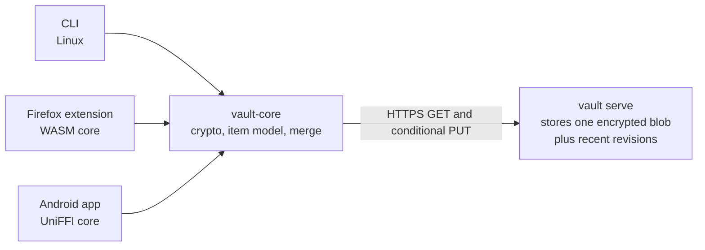

# Personal Password Manager: Requirements

Oct 12, 2026 · @Ned Wolpert · Draft 7

## Overview

A personal Bitwarden: one encrypted vault, mine, usable from the command line, from Android, and
from Firefox, synced through `vault serve` on a machine I run. Name: `vault`.

This is a restart of `../vlt`. That project's goals were right; its storage design was not. One
encrypted object per entry, S3 with IAM keys per device, hash-chained history, per-device key
wrapping, and backend capability probing produced a 2,200-line spec and 36,000 lines of Rust before
the first non-CLI client existed. This version trades those features for a design small enough to
finish.

### Goals

1. Replace Bitwarden for daily use on Linux, Android, and Firefox.
2. Zero-knowledge sync: the server stores one opaque blob and never sees plaintext, the master
   password, or the secret key. A bug in the server, or a stolen copy of its disk, exposes nothing
   that can be brute forced, as long as the current secret key has not left an enrolled device
   (see credential changes).
3. Easy to use: adding a device is "scan or paste the server token, scan or type the secret key,
   type the master password". No IAM and no enrollment protocol.
4. Easy sync: concurrent edits on two devices merge automatically, without conflict files.
5. Lossless import from Bitwarden, and an exit path to Bitwarden and plain JSON.
6. A design simple enough that the format spec fits in a few pages.

### Non-goals (v1.x)

- More than one user; sharing; organisations.
- Windows, macOS, iOS, and Chrome clients.
- Attachments.
- A hosted service for anyone but me.

## Releases

| Release | Scope |
| --- | --- |
| v1.0 | Logins and secure notes on CLI, Firefox, and Android, with sync, import, and export |
| v1.1 | TOTP: generate codes on every client; scan or paste `otpauth://` URIs |
| v1.2 | WebAuthn: passkey storage, Firefox authenticator, Android Credential Manager provider |

TOTP seeds and passkeys present in a Bitwarden import are stored and preserved from v1.0, so
nothing is lost before the features that use them ship.

## Architecture



### Vault file

The whole vault is one file: a small authenticated header followed by one AEAD ciphertext of every
item.

| Part | Contents |
| --- | --- |
| Header (authenticated, not secret) | Format version, generation number, KDF parameters and salt, vault key wrapped by the key derived from the master password and secret key |
| Body (encrypted with the vault key) | Every item, tombstones for deleted items, and vault settings |

The body's AEAD takes the complete header bytes as associated data, so a header cannot be moved
onto a different body, and the generation number cannot be changed, without detection.

At 1,000 items the file is a few hundred kilobytes, so every save rewrites the whole thing. That is
fine at this scale, and it removes indexes, per-entry objects, and cross-object consistency rules.

The same file is the backup format: copying it anywhere is a complete encrypted backup that any
client can open with the master password and the secret key.

### Keys

- The secret key is 128 random bits, generated by `vault init`, and held by every client. It is
  never sent to the server and never stored in the vault file.
- The master password and salt go through Argon2id; the result and the secret key go through HKDF
  to produce a key-encryption key, which unwraps a random 256-bit vault key. Unlocking needs both.
- Quick unlock (fingerprint, CLI agent, extension session) caches or wraps the vault key locally on
  that device only. Nothing device-specific is stored in the vault file.
- `vault init` prints an emergency kit: the secret key, as text and a QR code, and the server URL.
  The kit plus the master password opens the vault on a fresh device.
- `vault key show` displays the secret key on an existing client. It asks for the master password
  again, even while the vault is unlocked, and prints the text form; `--qr` adds a QR code of the
  same text. The key is shown on screen and never written to disk. The re-prompt protects against
  someone at an unlocked screen; it does not protect against malware running as the same user,
  which can read the secret key from the client's storage directly.

At rest on each client, the secret key lives in the OS keyring (CLI, falling back to a file
readable only by the user), the Android Keystore-protected app storage (Android), or extension
local storage (Firefox, which has no better place). Device theft therefore yields the secret key;
the master password still protects the vault, and the response is a credential change.

### Credential changes

`vault passwd` is the one credential-change operation. It always generates a new vault key and a
new salt and re-encrypts the body; the body is a few hundred kilobytes, so this costs nothing
noticeable. Options select what else changes:

| Command | New vault key | New master password | New secret key |
| --- | --- | --- | --- |
| `vault passwd` | Yes | Yes | No |
| `vault passwd --rekey` | Yes | No | No |
| `vault passwd --new-secret-key` | Yes | Optional | Yes |

- A new vault key on every change means an old header, together with the old credentials, opens
  only revisions written before the change. It never opens the current body.
- After any change, every other device's cached quick-unlock key is stale. Each device asks for the
  master password once (and the new secret key, if it changed) on its next unlock.
- `--new-secret-key` prints a new emergency kit. Every other device must have the new secret key
  entered, by the same means as adding a device. This is the response to a lost or stolen device,
  together with `vault serve token rm` for that device's token.
- Revisions written before a change stay readable with the old credentials for as long as the
  server retains them. `vault serve revisions prune --before <revision>` removes them on the server
  when that matters.

### Secret key text form

The secret key has one canonical text form, carried over unchanged from `../vlt`: the prefix
`VLT1-`, then eight groups of four Crockford base32 characters encoding the 16-byte key followed by
a 4-byte check value (a truncated SHA-256 of the key under a fixed domain label).

```text
VLT1-XXXX-XXXX-XXXX-XXXX-XXXX-XXXX-XXXX-XXXX
```

- Decoding ignores case, dashes, and spaces, and reads `O` as `0` and `I` or `L` as `1`.
- A check value mismatch is reported as a typo before any key derivation runs, so a mistyped key
  never looks like a wrong master password.
- Every QR code that carries the secret key (the emergency kit, `vault key show --qr`) encodes this
  same text. There is no second format.

### Sync

Every client keeps a full local copy of the vault file and works offline.

1. Pull: `GET` the file with its `ETag`.
2. Merge: decrypt and merge the remote items with local changes, item by item (see below).
3. Push: `PUT` with `If-Match` on the `ETag` from step 1. A `412` means another device wrote first;
   repeat from step 1.

Merge rule: each item has a UUID and a modification stamp (timestamp plus device ID as the tie
break). For each item ID the newer stamp wins. When the losing version had a different password,
that password goes into the winner's password history, so a concurrent edit never silently
discards a secret.

- A stamp more than 24 hours ahead of the merging device's clock is clamped to that clock and the
  item is flagged for review. One device with a wrong clock, or a thief with the vault key, cannot
  make an item win every future merge.
- Deletes are tombstones, kept for 180 days and then dropped. The body records a purge horizon:
  the stamp before which tombstones have been dropped. A local-only item stamped before the remote
  purge horizon is treated as deleted and shown for review, never pushed back. A device offline for
  longer than 180 days, or an old backup, does not resurrect deleted items.
- A credential change (`vault passwd`) on one device and a concurrent write on another resolve
  through the conditional `PUT`: the loser re-pulls, finds a header it cannot open with its cached
  key, and asks for the master password.

Clients sync on unlock, after every local change, and on a timer while unlocked.

### Rollback protection

Every push to the server increments the generation number in the authenticated header; local
saves between syncs do not. Each client remembers the highest generation it has accepted from a
file that opened. A remote file with a lower generation is an integrity error, shown to the user
and never merged. This stops a stolen token, or a server bug, from re-serving an old
revision to undo a password change or bring back old items.

- A deliberate restore (CORE-9) writes the restored content as a new revision with a higher
  generation, and re-stamps the restored items with the current time so the next merge keeps them.
- A remote file that does not decrypt (garbage pushed with a stolen token, or corruption) is also
  an integrity error. The client keeps its local copy, warns, and stops syncing until
  `vault sync --recover` merges into the newest honest server revision (or, failing that, pushes
  the local copy). It never treats an unreadable remote as an empty vault.
- A brand-new device has no remembered generation, so it cannot detect a rollback on its first
  sync. This is a residual risk; the device does detect any later rollback.

### Server

`vault serve` is a subcommand of the one `vault` binary. It runs on a machine that stays on (a home
desktop, a NAS, or a VPS) and is the sync base for every other client.

The server is dumb. It stores bytes and tokens, and nothing else:

- It never unlocks the vault, never merges, and never holds the vault key, master password, or
  secret key.
- Its data directory is separate from the local client's state on the same machine. The `vault` CLI
  on that machine is an ordinary client talking to the server over `localhost`.
- A build feature produces a server-only binary, with no vault code, for hosts that never run the
  CLI.

| Endpoint | Behaviour |
| --- | --- |
| `GET /v1/vault` | Returns the current blob and its `ETag`, or `404` before the first push |
| `PUT /v1/vault` | Stores a new blob if `If-Match` (or `If-None-Match: *`) holds; otherwise `412` |
| `GET /v1/revisions` | Lists retained revisions |
| `GET /v1/revisions/<id>` | Returns one retained revision |

- Authentication is a bearer token per device, stored hashed. `vault serve token add <name>`
  prints a token; `vault serve token ls` and `vault serve token rm <name>` list and revoke. These
  subcommands edit the server's data directory directly; there is no admin API over the network.
- The server keeps the newest 100 revisions, one revision per device per day for 90 days, and
  each device's newest revision. Restoring one is a client operation: download, inspect, push as
  a new revision.
- A blob larger than 16 MB, or one not shaped like a vault file, is refused. Total storage has a
  quota (2 GB by default) that charges every revision at least 8 KB, and at most 10,000 revisions
  are kept; at either limit the server refuses pushes rather than delete retained revisions. A
  stolen token can therefore stop sync, but cannot fill the disk or erase history. Garbage pushed
  with a stolen token cannot push out each other device's newest revision.
- Each revision records the token that pushed it, so `vault serve token ls` shows each device's last
  push and a misbehaving token is identifiable.
- Storage is a directory on disk.
- The server sends no CORS headers. The Firefox extension reaches it through host permissions.

### Transport

- Clients refuse plain `http` to anything except loopback. A token sent in clear on the home
  network would let anyone on that network push revisions.
- `vault serve` serves TLS with its own certificate or sits behind a reverse proxy. For a
  self-signed certificate, `vault serve token add` includes its SHA-256 fingerprint in the URL and
  QR code, and the CLI and Android pin it. For a publicly trusted certificate (a reverse proxy with
  Let's Encrypt, which renews every 60 to 90 days), the fingerprint is left out and clients use
  ordinary certificate validation.
- Firefox extensions cannot pin a certificate themselves, and `webRequest.getSecurityInfo()`
  returns no certificates for a host trusted through an exception. Firefox trusts `vault serve`
  through a certificate exception instead: the user opens the server URL in a tab once and accepts
  the certificate, after checking that the fingerprint Firefox shows matches the one in the
  `token add` output. Firefox stores the exception with the certificate's fingerprint and refuses
  the connection if the server later presents a different certificate, so the exception acts as a
  pin enforced by Firefox.
- An exception belongs to one host name and port. `localhost` and `127.0.0.1` are separate, so the
  extension uses the exact host name the exception was accepted for.
- When `vault serve` runs on the same machine as Firefox, the extension uses `http://localhost` and
  no certificate is involved. Firefox exempts loopback from the Manifest V3 default
  `upgrade-insecure-requests` and from HTTPS-Only Mode.
- A publicly trusted certificate (for example, Let's Encrypt through a DNS-01 challenge, which
  works for a host not reachable from the internet) also works, with no exception needed. It is
  an option for a user who already has a domain, not a requirement.

These Firefox behaviours were tested on 2026-10-12 against Firefox 157 (headless, temporary
Manifest V3 extension, fetches from an extension page; exceptions added through the certificate
override service that the "Accept the Risk and Continue" button calls):

| Request from the extension | Result |
| --- | --- |
| `https://localhost`, self-signed certificate, no exception | Fails |
| Same, after an exception for `localhost` on that port | Succeeds |
| `https://127.0.0.1`, same port, with only the `localhost` exception | Fails |
| Exception stored for certificate A, server presenting certificate B | Fails |
| `http://localhost` and `http://127.0.0.1`, default Manifest V3 policy | Succeeds, not upgraded |
| Same, with HTTPS-Only Mode on | Succeeds |

Because every client holds a full copy, losing the server loses nothing but revision history.

### Adding a device

A new device needs two separate credentials from two separate places, plus the master password.

| Credential | Comes from | Grants |
| --- | --- | --- |
| Server URL and token | `vault serve token add <name>` on the server | The encrypted vault file |
| Secret key | `vault key show` on any existing client, or the emergency kit | Nothing on its own |
| Master password | Memory | Nothing without the secret key |

The server and the secret key never meet: `vault serve` does not need a client on the same machine,
and no client sends the secret key anywhere.

1. On the server, run `vault serve token add <name>`. It prints the server URL and token as text and
   as a QR code.
2. On the new device, scan the QR code (Android) or paste the text (Firefox, CLI). Firefox, when
   the server is not on `localhost`, then opens the server URL in a tab, and the user accepts the
   certificate after comparing its fingerprint with the one in the `token add` output.
3. On an existing client, run `vault key show` (or `vault key show --qr`). On the new device, type
   or paste the text, or scan the QR code (Android).
4. On the new device, type the master password. The device downloads the vault file and unlocks.

Recovery from the emergency kit is the same flow, with the secret key read from the kit in step 3.
Onboarding and recovery share one code path.

### Implementation stack

Recommendation: stay with Rust, with a hard ceiling on core complexity.

| Option | For | Against |
| --- | --- | --- |
| Rust (recommended) | One core runs natively in the CLI, via UniFFI on Android, and via WASM in Firefox; the server is a subcommand of the same binary; RustCrypto is mature; parts of `../vlt` carry over | Slower to write than the alternatives; Android build glue |
| Go | Fast to write; excellent CLI and server | `gomobile` is awkward; WASM output is several MB; weaker crypto library story for Argon2id in WASM |
| TypeScript | Native in the extension | CLI needs Node or Bun; no good path to a native Android core |
| Kotlin Multiplatform | Native on Android | Immature for CLI and WASM; thin crypto libraries |

Candidates to salvage from `../vlt`: the secret key text form (`secret_key_text.rs` and the
Crockford codec in `textcodec.rs`), the password and diceware generator with its word list, the
Argon2id and XChaCha20-Poly1305 wrappers and their secret types, clipboard handling, the CLI
agent, the Bitwarden import mapping, and the CI and `cargo-deny` configuration. Everything about
storage, indexes, history chains, devices, and enrollment stays behind.

## Threat model

| Adversary | Can do | Must not be able to |
| --- | --- | --- |
| Anyone with the server's disk or traffic | Read every revision of the blob, its size, and write times | Read any item, name, URL, or username without the master password |
| Thief with a device's sync token | Read the blob and every revision; push garbage revisions; re-push an old revision; stop sync by filling the quota | Decrypt anything; destroy the retained revisions (the server never deletes a revision on request); roll back any device that has synced before (rollback protection) |
| Server bug or misconfiguration (blob served without auth, data directory leaked) | Read the blob and every revision | Decrypt anything, even by offline guessing of the master password, because the current secret key is not on the server |
| Attacker on the home network | Observe and modify traffic | Read a token, or substitute a server (TLS required; certificate pinned on CLI and Android) |
| Thief with a locked device | Copy the local encrypted cache and the secret key | Unlock without the master password or that device's biometric or OS login |
| Malicious web page | Trigger fill prompts; embed frames; send messages to content scripts | Receive credentials for a different site; fill without a user action; learn anything about other items |
| Malicious Android app | Claim another app's package name; host a WebView and report a web domain | Receive credentials saved for a different app or site without a confirmation showing its real identity |
| Me, later | Forget the master password, or lose every device | Lose the vault while any device still unlocks with a biometric or agent session (that device can set a new password), or while I have the emergency kit and the master password |

A quick-unlock session can set a new master password without the old one. That is the recovery
path in the last row, and it cuts both ways: someone who gets past a device's biometric or reaches
a live CLI agent can change the password and lock the other devices out until the token is revoked
and the password changed back from the emergency kit. This is accepted.

The secret key is there because the server is the component most likely to have a bug: it is new
code, exposed to the network. With the secret key, a leaked blob is 128 bits plus a password away
from being read, so the server's security is not load-bearing for confidentiality.

The residual risk is a stolen device: it holds the blob and the secret key, so the master password
is the remaining barrier against offline guessing. Defences are Argon2id parameters sized for the
slowest client, a diceware passphrase offered at `vault init`, and a warning for weak passwords.
After a device loss, `vault passwd --new-secret-key` restores the server-side guarantee for every
revision written from then on.

Security principles:

- Standard primitives only: Argon2id, XChaCha20-Poly1305, HKDF-SHA-256. No custom constructions and
  no post-quantum hybrid (nothing in this design uses public-key crypto).
- The body's AEAD authenticates the whole header, including the generation number.
- KDF parameters are read before anything can be verified, so authentication alone does not
  protect them. Every client rejects Argon2id parameters below the floor or above a ceiling before
  running Argon2id, whatever the vault file's source: the server, a backup, or an export. An
  import from another format (a Bitwarden export) has that format's lower bounds, but never
  exceeds the ceiling. The
  floor stops a client from writing weak parameters; the ceiling stops a file from exhausting
  memory, which matters most in the Firefox WASM build.
- Plaintext lives only in memory, with two stated exceptions: `vault edit` (CLI-4) and plaintext
  export (CLI-8). Clipboard copies clear after 45 seconds.
- Every client refuses to write a format version newer than it understands, and every client
  preserves fields it does not understand.

## Item model

| Type | Fields |
| --- | --- |
| Login | Name, folder, username, password, URIs (each with a match mode), notes, custom fields, favourite flag |
| Secure note | Name, folder, notes, custom fields, favourite flag |

Every item also carries: UUID, created and modified stamps, password history (last 10), a `totp`
field (stored in v1.0, used in v1.1), and a `passkeys` list (stored in v1.0, used in v1.2).

- Custom fields are text or hidden.
- Folders are a path string (`Work/AWS`), one level or many.
- Bitwarden cards and identities import as secure notes with named custom fields, so no data is
  lost. Dedicated card and identity types are a later option, not a v1 requirement.
- URI match modes follow Bitwarden: base domain (default), host, exact, starts with, never.
- Login items record, per Android app, the signing certificate digest seen at first fill or save.

## Autofill matching

These rules hold on every client that fills, and the threat model's web page and Android app rows
depend on them.

Firefox:

- Base domain means the registrable domain (eTLD+1) from the Public Suffix List. An item for one
  `github.io` site does not match another.
- An `https` URI never fills an `http` page without a confirmation.
- Fill reaches only frames whose origin matches the item. A cross-origin iframe is never filled.
- The origin comes from the browser (the message sender and the tab URL), never from the page or a
  message a content script relays from it.
- The decrypted vault stays in the background script. A content script receives only the one
  credential being filled, and only after the user action.
- Nothing is ever written to `storage.sync`.

Android:

- An app match is bound to the app's signing certificate digest, recorded at first fill or save.
  If the digest differs, or none is recorded, the user confirms, with the app's label and package
  name shown, before anything fills.
- A web domain reported by the autofill request is used only when the requesting app is on an
  allowlist of browser packages. From any other app, matching is by package name and certificate,
  so a WebView inside an ordinary app cannot ask for a website's credentials.

## Functional requirements

P0 blocks v1.0; P1 should land in v1.0 but does not block it; P2 is after v1.0.

### Core

| ID | Requirement | Priority |
| --- | --- | --- |
| CORE-1 | Create, read, update, and delete logins and secure notes | P0 |
| CORE-2 | Unlock with master password and secret key; `passwd` changes credentials with a new vault key every time | P0 |
| CORE-13 | Generation number in the authenticated header; rollback detected and reported, never merged | P0 |
| CORE-14 | Merge clamps future stamps and honours the purge horizon | P0 |
| CORE-15 | Argon2id parameter floor and ceiling checked before derivation, for every source | P0 |
| CORE-16 | An undecryptable or rolled-back remote keeps the local copy, warns, and stops syncing; `vault sync --recover` repairs it | P0 |
| CORE-11 | Emergency kit at `vault init`: secret key as text and QR code, plus the server URL | P0 |
| CORE-12 | Secret key text form: `VLT1-` Crockford base32 with check value; forgiving decoder; typos reported before key derivation | P0 |
| CORE-3 | Password generator: length, character classes, ambiguous-character exclusion, diceware passphrases | P0 |
| CORE-4 | Search by name, folder, username, and URI | P0 |
| CORE-5 | Offline use from the local copy; sync and merge as described above | P0 |
| CORE-6 | Preserve unknown fields across read, edit, and write | P0 |
| CORE-7 | Password history per item, including passwords lost in a merge | P0 |
| CORE-8 | `passwd --new-secret-key`: secret key rotation with a new emergency kit | P1 |
| CORE-9 | Restore the whole vault, or a single item, from a server revision, as a new generation with re-stamped items | P1 |
| CORE-10 | Health report: reused, weak, and old passwords | P2 |

### Server

| ID | Requirement | Priority |
| --- | --- | --- |
| SRV-1 | `GET` and conditional `PUT` of one blob, with `ETag` | P0 |
| SRV-2 | Per-device bearer tokens: `vault serve token add`, `ls`, `rm`, editing the data directory locally; no network admin API; `add` prints the URL and token as text and QR code | P0 |
| SRV-7 | The server never receives, stores, or logs the secret key, master password, or vault key | P0 |
| SRV-3 | Revision retention: newest 100, one per device per day for 90 days, and each device's newest | P0 |
| SRV-9 | 16 MB blob limit; storage quota that refuses pushes instead of deleting revisions | P0 |
| SRV-10 | Each revision records its pushing token; `token ls` shows each token's last push | P0 |
| SRV-11 | `vault serve revisions prune --before <revision>`, run locally on the server | P1 |
| SRV-4 | `vault serve` in the `vault` binary for Linux x86\_64 and arm64; data in its own directory, separate from client state | P0 |
| SRV-5 | TLS with a supplied certificate, or plain HTTP bound to localhost behind a TLS reverse proxy; `token add` output carries the certificate fingerprint for a self-signed certificate; no CORS headers | P0 |
| SRV-6 | Server-only build with no vault code | P1 |
| SRV-8 | Container image | P2 |

### CLI (Linux)

| ID | Requirement | Priority |
| --- | --- | --- |
| CLI-1 | Verbs: `init`, `setup` (prompts for server URL and token, secret key, and master password), `key show [--qr]`, `serve`, `unlock`, `lock`, `ls`, `show`, `add`, `edit`, `rm`, `mv`, `gen`, `find`, `sync`, `passwd` | P0 |
| CLI-11 | Refuse plain `http` except to loopback; pin the server certificate fingerprint from setup | P0 |
| CLI-2 | `show -c` copies the password (or `--field <name>`) and clears it after 45 s; X11 and Wayland | P0 |
| CLI-3 | Agent keeps the vault unlocked for a configurable idle time | P0 |
| CLI-4 | `edit` opens the item in `$EDITOR` as a readable text form, written only to a private (mode 0700) directory on a tmpfs and removed afterwards; known editor side files (Vim swap, undo, and viminfo; Emacs auto-save and backup) are disabled for that file. Other editors may still write elsewhere, and the documentation says so | P0 |
| CLI-5 | `--json` output and stable exit codes | P0 |
| CLI-6 | bash, zsh, and fish completion | P0 |
| CLI-7 | `import bitwarden <file>` for plain and password-protected JSON exports | P0 |
| CLI-8 | `export` to encrypted vault file, Bitwarden JSON, and plain JSON; plaintext formats need an explicit flag and go to stdout or a new mode 0600 file, with a warning | P0 |
| CLI-9 | `history` and `restore` over server revisions | P1 |
| CLI-10 | rofi, fuzzel, or dmenu picker | P1 |

### Firefox extension

| ID | Requirement | Priority |
| --- | --- | --- |
| FF-1 | Standalone: WASM core, talks to the server directly, no CLI required | P0 |
| FF-8 | Setup by pasting the server URL and token; for a remote server, accepting the certificate exception in a tab after a fingerprint check the extension prompts for; then typing or pasting the secret key, then entering the master password | P0 |
| FF-2 | Popup: search, view, copy username and password | P0 |
| FF-3 | Fill username and password on the current page from a user action (popup, keyboard shortcut, or context menu), following the autofill matching rules | P0 |
| FF-9 | Server certificate trusted through a Firefox certificate exception (or a publicly trusted certificate); the extension uses the exact host name the exception covers; plain `http` only to loopback | P0 |
| FF-4 | Lock after a configurable idle time and on browser close | P0 |
| FF-5 | Add and edit items; generate a password into a field | P1 |
| FF-6 | Offer to save or update after a login form submits | P1 |
| FF-7 | PIN unlock for the current browser session; the PIN-wrapped key is held only in `storage.session` (memory), never on disk | P2 |

### Android

| ID | Requirement | Priority |
| --- | --- | --- |
| AND-1 | Setup by scanning the server token QR code, then scanning or typing the secret key (from `vault key show` or the emergency kit), then entering the master password | P0 |
| AND-8 | Show the secret key as text and QR code after re-entering the master password | P1 |
| AND-2 | Browse, search, view, and copy; copied secrets flagged sensitive | P0 |
| AND-3 | Autofill service for apps and browsers, following the autofill matching rules (signing certificate binding; web domains only from allowlisted browsers) | P0 |
| AND-4 | Biometric unlock: the cached vault key is wrapped by a Keystore key that requires strong biometric authentication for every use (`CryptoObject`) and is invalidated when a new biometric is enrolled | P0 |
| AND-9 | Refuse plain `http`; pin the server certificate fingerprint from the setup QR code | P0 |
| AND-5 | Add, edit, and generate | P0 |
| AND-6 | Offline use from the local copy | P0 |
| AND-7 | Minimum Android 10 | P0 |

### v1.1: TOTP

| ID | Requirement |
| --- | --- |
| TOTP-1 | Core computes RFC 6238 codes (SHA-1, SHA-256, SHA-512; 6 or 8 digits; any period) from the `totp` field |
| TOTP-2 | CLI: `vault otp <item> [-c]` |
| TOTP-3 | Firefox: show code with countdown; copy code to the clipboard after a fill |
| TOTP-4 | Android: show code with countdown; scan an `otpauth://` QR code to set the field |
| TOTP-5 | Accept a pasted `otpauth://` URI or a bare base32 secret everywhere |

### v1.2: WebAuthn

| ID | Requirement |
| --- | --- |
| WA-1 | Item model stores discoverable passkeys (credential ID, private key, RP ID, user handle, counter) |
| WA-2 | Firefox: act as a WebAuthn authenticator for registration and assertion, with an explicit user confirmation |
| WA-3 | Android: Credential Manager provider for passkeys (Android 14 and later) |
| WA-4 | CLI: list and delete passkeys; no assertion support |
| WA-5 | Passkeys imported from Bitwarden in v1.0 become usable without re-import |

## Non-functional requirements

| Area | Requirement |
| --- | --- |
| Setup | New vault to first synced item in under 5 minutes; adding a device in under 2 minutes, including typing the secret key |
| Unlock | Argon2id at 64 MiB and 3 iterations by default, about 1 s or less on the slowest client (Firefox WASM or the phone); 128 or 256 MiB only by explicit choice |
| Latency | `show` from a warm agent under 100 ms with no network; sync runs in the background |
| Sync | A change on one online device is visible on another within 10 s of that device's next sync |
| Scale | 2,000 items without noticeable slowdown; vault file under 2 MB |
| Durability | Every client holds a full copy; the server retains revisions per SRV-3 |
| Recovery | Emergency kit plus master password plus a new token opens the vault on a fresh device |
| Integrity | No client ever merges a lower generation or treats an unreadable remote as empty |
| Cost | One small process on hardware I already run |
| Licence | MIT; dependencies MIT, Apache-2.0, BSD, ISC, Zlib, or Unicode, enforced by `cargo-deny`; one exception, `webpki-roots` (CDLA-Permissive-2.0), because it is the Mozilla root set the CLI trusts for a publicly trusted certificate |
| Simplicity | Format spec (header, body, item schema, merge rule, server API) kept as short as the rules allow; no client-specific data in the vault file |

## Complexity guardrails

The previous attempt grew by accepting each feature that was individually reasonable. These are
off the table unless a concrete problem forces them back, and adding one needs a written reason:

- Per-item files or objects, and any index over them.
- S3, IAM, or any cloud-provider-specific storage integration.
- Per-device keys or wrapped copies of the vault key in the shared file.
- A server that unlocks, merges, or otherwise understands the vault.
- Any per-device variant of the secret key. Rotation of the one shared secret key is allowed
  (written reason: without it, one lost device permanently removes the server-side guarantee).
- Hash-chained or client-maintained history (the server's revisions are the history).
- Post-quantum or public-key cryptography.
- Pluggable storage backends. One server API; other transports come later, if ever, as adapters.

## Migration and exit

| Direction | Format | Notes |
| --- | --- | --- |
| Import | Bitwarden JSON (plain and password-protected) | Folders become folder paths; cards and identities become notes with custom fields; TOTP and passkeys preserved; KDF parameters in a password-protected export are bounds-checked; after import, a reminder to delete the source file |
| Export | Encrypted vault file | The native backup; opens on any client with the master password and secret key |
| Export | Bitwarden JSON | The exit path; re-importable into Bitwarden or Vaultwarden; same handling as plain JSON |
| Export | Plain JSON | Behind an explicit flag; stdout or a mode 0600 file |

Acceptance test: import my real Bitwarden export, export to Bitwarden JSON, and diff field by field
with zero unexplained losses.

## Phasing

1. Format spec and core: vault file, keys, item model, merge rule, rollback protection, test
   vectors.
2. Server and CLI, including import and export. Exit: daily CLI use for 2 weeks alongside Bitwarden.
3. Firefox extension. First, confirm the transport test results from a background script as well
   as an extension page. Exit: Bitwarden extension removed.
4. Android app. Exit: Bitwarden uninstalled from the phone; v1.0 tagged; Bitwarden account closed.
5. v1.1 TOTP, then v1.2 WebAuthn.

## Decisions and open questions

| Topic | Proposed decision |
| --- | --- |
| Storage model | One encrypted vault file, item-level merge |
| Sync transport | `vault serve`, a dumb blob server in the `vault` binary, with conditional `PUT` (decided 2026-10-12) |
| Secret key | Required in v1.0, never held by the server; rotatable with `passwd --new-secret-key` (decided 2026-10-12) |
| Credential changes | Every `passwd` generates a new vault key and re-encrypts the body (decided 2026-10-12) |
| Device setup | Server token from `vault serve token add`; secret key from `vault key show` or the kit, typed, pasted, or scanned (decided 2026-10-12) |
| Network reach | v1.x assumes clients reach `vault serve` on the home network; away from home, the phone works from its local copy and syncs on return (decided 2026-10-12) |
| Secret key format | `VLT1-` Crockford base32 with check value, reused unchanged from `../vlt` (decided 2026-10-12) |
| Client order | CLI, then Firefox, then Android (decided 2026-10-12) |
| Firefox architecture | Standalone WASM, not native messaging to the CLI (decided 2026-10-12) |
| Firefox server trust | Certificate exception accepted once in Firefox, which pins the certificate; `http://localhost` when the server is local (decided and tested 2026-10-12) |
| FreeBSD | Not in v1.x; a future direction (decided 2026-10-12) |
| Data model | Bitwarden-shaped items with pass-style CLI verbs, not pass's text format |
| Stack | Rust |
| Name | `vault` for the binary and the crates (`vault-core`); the secret key prefix stays `VLT1-` (decided 2026-10-12) |

Still open: nothing at the requirements level. The format spec settles the rest.

## Deferred to the format spec

Raised in the security review of Draft 3. `spec/format.md` settles each of these:

- HKDF inputs and domain labels, and a fresh salt on every credential change.
- The wrap AEAD's associated data covers format version, flags, vault ID, KDF parameters, and
  salt, but not the generation. The body AEAD authenticates the whole header, generation included,
  so routine writes need only the vault key, which is all a quick-unlocked client holds.
- Random 24-byte XChaCha20 nonces on every seal, never derived from a counter or the `ETag`.
- Concurrent credential changes: no tie-break rule is needed, because a credential change runs only
  online and the conditional `PUT` lets exactly one win; the other aborts.
- XChaCha20-Poly1305 is not key-committing. Partitioning-oracle attacks are infeasible because the
  128-bit secret key is an input to the key-encryption key; the spec records this.

## Client design

Rules for individual clients that are not part of the shared format. Each client's design document
settles the details:

- CLI agent socket in `$XDG_RUNTIME_DIR`, mode 0600, with an `SO_PEERCRED` user check.
- Clipboard: password-manager MIME hints (`x-kde-passwordManagerHint`) so clipboard managers skip
  copied secrets; clearing after 45 seconds does not purge a manager's history.
- WebAuthn (v1.2): RP ID checked against the origin the browser reports; signature counter fixed at
  0, because synced passkeys and last-writer-wins merge make counters go backwards; UV flag set only
  after a real unlock; cross-origin iframe calls handled. Passkeys registered on two devices for the
  same item at once may need a union merge rule; v1.2 decides.

## Future directions

Not scheduled for any release. Each needs its own requirements pass before it is picked up.

| Direction | Notes |
| --- | --- |
| FreeBSD | CLI and `vault serve` built and tested on FreeBSD amd64 |
| Remote reach | Sync with `vault serve` from away from home: public host with TLS, a VPS, or Tailscale |
| Pairing code | A short code relayed through the server (Magic Wormhole style) instead of typing the secret key; rejected for v1.x because it adds a key-exchange protocol and makes the server part of key transfer |
| S3 or RustFS transport | The same get and conditional put over an S3-compatible bucket, for running without `vault serve` |
