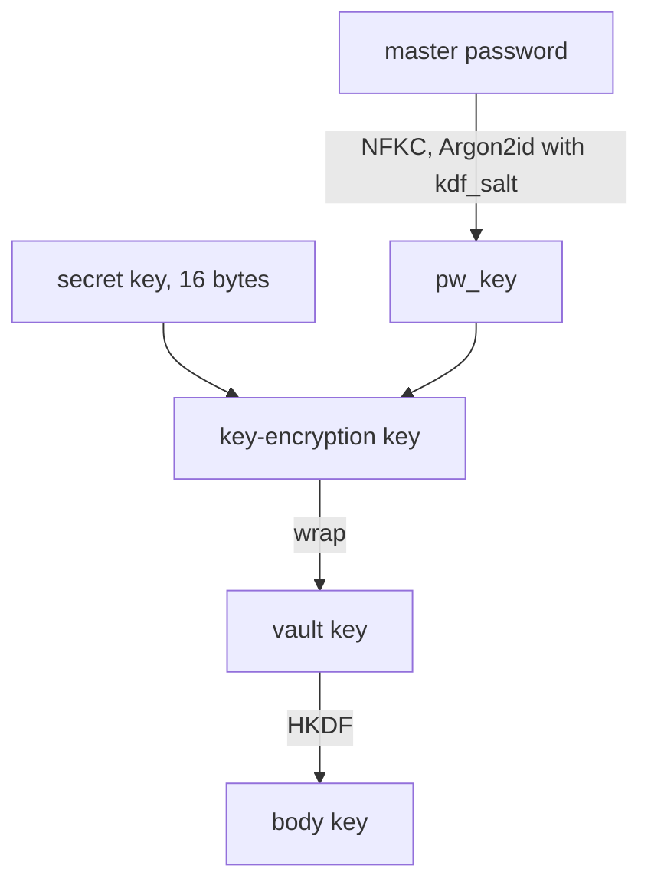

# vault format spec

The vault file, its keys, the item schema, the merge rule, sync and rollback protection, the
server API, and the text forms that clients exchange. The test vectors in `spec/vectors/` are its
executable form.

## Conventions

| Notation | Meaning |
| --- | --- |
| `a \|\| b` | Byte concatenation |
| `u16`, `u32`, `u64` | Unsigned integers, big-endian |
| `bN` | Exactly `N` raw bytes |
| `"label"` | The ASCII bytes of the label, no terminator |
| `HKDF(ikm, salt, info)` | HKDF-SHA256 (RFC 5869), 32-byte output |
| `AEAD(key, nonce, pt, ad)` | XChaCha20-Poly1305 seal; output is ciphertext followed by the 16-byte tag |
| `rand(N)` | `N` bytes from the operating system CSPRNG |
| `crock(b)` | Crockford base32 of `b` (alphabet `0123456789ABCDEFGHJKMNPQRSTVWXYZ`, most significant bit first, no padding) |
| `ms` | Milliseconds since 1970-01-01T00:00:00Z, as an integer in `[0, 2^53)` |
| `a ⊖ b` | Saturating subtraction: `a - b`, or `0` when `b > a` |

Every binary structure is parsed strictly. A decoder rejects a wrong magic, an unknown format
version, unknown flag bits, lengths that run past the end of the input, trailing bytes, non-zero
padding, and values outside the stated bounds. A rejection is an integrity error: the operation
fails and nothing is written.

The vault ID and device IDs are 16 random bytes. Their text form is 32 lowercase hex characters.

## Primitives

| Purpose | Primitive | Crate |
| --- | --- | --- |
| Password stretching | Argon2id, version `0x13` (RFC 9106) | `argon2` |
| Key derivation | HKDF-SHA256 | `hkdf`, `sha2` |
| AEAD | XChaCha20-Poly1305 | `chacha20poly1305` |
| Password normalisation | Unicode NFKC | `unicode-normalization` |
| Randomness | OS CSPRNG | `getrandom` |
| Secret hygiene | Zero on drop | `zeroize` |

Nonces are 24 random bytes, generated for every seal. They are never derived from a counter, a
generation number, or an `ETag`, so no nonce state has to survive a crash or be shared between
devices. At the write volume of one user, random 192-bit nonces carry no practical collision risk.

XChaCha20-Poly1305 is not key-committing. Partitioning-oracle attacks do not apply, because every
key that opens an AEAD here is derived from an input that includes the 128-bit secret key or the
vault key.

## Keys



### Secret key

The **secret key** is 16 random bytes generated at `vault init`. It is held by every client and
printed in the emergency kit. It never appears in the vault file and is never sent to the server.

### Key-encryption key

```
pw_key = Argon2id(password = NFKC(master_password) as UTF-8,
                  salt = kdf_salt, m = m_kib, t = t, p = p, output = 32 bytes)
KEK    = HKDF(ikm = pw_key || secret_key, salt = vault_id, info = "vault/v1/kek")
```

The **key-encryption key** (KEK) needs both the master password and the secret key. The master
password is not trimmed, and is at most 4,096 bytes of UTF-8 before normalisation, which bounds the
memory NFKC can need; a longer input is refused at unlock and when setting a password. Setting a
password (`vault init`, `vault passwd`) requires at least 12 Unicode scalar values after NFKC
normalisation and rejects code points unassigned in the client's Unicode tables, because NFKC is
stable across Unicode versions only for assigned code points. Unlocking applies neither of these
last two rules.

### Vault key and body key

The **vault key** (VK) is 32 random bytes. It is replaced by every credential change. The body key
is derived from it:

```
K_body = HKDF(ikm = VK, salt = vault_id, info = "vault/v1/body")
```

## KDF parameters

| Set | `m_kib` | `t` | `p` | Allowed in |
| --- | --- | --- | --- | --- |
| Floor | 65,536 (64 MiB) | 3 | 1 | Every build |
| Ceiling | 262,144 (256 MiB) | 10 | 4 | Every build |
| Test | 64 | 1 | 1 | Test builds only, with the header flag `test_kdf` set |

A client checks the parameters against the floor and the ceiling before it runs Argon2id, whatever
the vault file's source: the server, a backup, or an export. A header with parameters outside the
bounds is rejected unless `test_kdf` is set, the client is a test build, and the parameters are the
test set; release builds reject `test_kdf` outright. The parameters are read before anything can be
authenticated, so this check is their only protection. The ceiling keeps a hostile file from
exhausting memory in the WASM and Android builds. An import from another format checks that
format's KDF parameters against bounds the importing client documents, with memory and iterations
never above the ceiling.

`vault init` and `vault passwd` write the floor parameters (`m_kib = 65,536`, `t = 3`, `p = 1`)
unless `--kdf-memory` selects 128 or 256 MiB. The floor keeps a password unlock in the Firefox WASM
build and on a slow phone near 1 s. No client measures and raises the parameters on its own,
because the device running `vault init` is usually the fastest one.

## Vault file

A **vault file** is a header, a body nonce, and a body ciphertext:

```
vault_file = header || body_nonce || body_ct
```

### Header

| Offset | Field | Type | Contents |
| --- | --- | --- | --- |
| 0 | `magic` | `b5` | `"VAULT"` |
| 5 | `format_version` | `u16` | `1` |
| 7 | `flags` | `u16` | Bit 0 is `test_kdf`; every other bit is zero |
| 9 | `vault_id` | `b16` | Random at `vault init`; constant for the life of the vault |
| 25 | `generation` | `u64` | In `[1, 2^48]`; `1` at `vault init` |
| 33 | `m_kib` | `u32` | Argon2id memory |
| 37 | `t` | `u32` | Argon2id iterations |
| 41 | `p` | `u32` | Argon2id lanes |
| 45 | `kdf_salt` | `b16` | Argon2id salt |
| 61 | `wrap_nonce` | `b24` | Nonce of the vault key wrap |
| 85 | `wrapped_vk` | `b48` | The wrapped vault key and its tag |

The header is 133 bytes. The vault key wrap is:

```
wrap_ad    = magic || format_version || flags || vault_id || m_kib || t || p || kdf_salt
wrapped_vk = AEAD(KEK, wrap_nonce, VK, wrap_ad)
```

`wrap_ad` leaves out `generation`, so a routine write does not re-seal the wrap and needs only the
vault key, which is all a quick-unlocked client holds. The body authenticates the generation
instead. A `wrap_nonce` identifies one wrap, and so one credential state, for the life of the vault.

### Body

```
plaintext = u32(len(json)) || json || zero padding
body_ct   = AEAD(K_body, body_nonce, plaintext, ad = header)
```

- `body_nonce` is `b24`, fresh for every seal.
- The associated data is all 133 header bytes. A header moved onto another body, a changed
  generation, or an old wrap on a new body fails authentication.
- A decoder requires `len(plaintext)` to be a multiple of 4,096, `4 + len(json) <= len(plaintext)`,
  and every padding byte to be zero. An encoder pads to the next multiple of 4,096, so the file
  size reveals the item count only roughly.
- A vault file is at most 16 MiB (16,777,216 bytes).

### Opening a file

1. Parse the header and check the KDF parameters.
2. Obtain the vault key: from the client's cache when the header's `wrap_nonce` is the client's
   current one, or otherwise by deriving the KEK and opening `wrapped_vk`.
3. Derive `K_body`, open `body_ct`, check the padding, and parse the JSON under the body rules.

A failure at step 2 with typed credentials means a wrong master password or secret key; the secret
key's check value has already ruled out a typo. A failure at step 3 is an integrity error.

An unlock with typed credentials pulls first when the server is reachable. When the remote carries
a `wrap_nonce` that is neither current nor retired, the unlock runs the credential change on
another device flow instead of trying the local file, so a new password typed after a change
elsewhere is not reported as wrong. A remote whose `wrap_nonce` the client refused earlier does not
replace the local file; the unlock opens the local file, and the sync reports the refused wrap, so
garbage under a fresh `wrap_nonce` cannot stop a device from unlocking.

## Body schema

The body is one UTF-8 JSON object, without a byte order mark. Object keys this spec does not
define are unknown fields. A client keeps unknown fields, at every level, through every read, edit,
merge, and write.

These JSON rules are checked after decryption and apply to unknown fields too:

- A duplicate key in any object is an integrity error.
- Nesting is at most 32 levels, counting each object or array as one level and the outer object as
  level 1.
- Every number is an integer in `[0, 2^53)` written without a sign, fraction, or exponent. Any
  other number, `-0` included, is an integrity error.
- Every key the schema defines is required, except `review` and `origin`, except `login` on items
  whose `type` is not `"login"`, and except the keys that an item of unknown `type` does not need
  (see items).

```json
{
  "v": 1,
  "horizon": 0,
  "items": [],
  "tombstones": []
}
```

| Key | Type | Contents |
| --- | --- | --- |
| `v` | integer | Body schema version, at least `1`; `1` for this spec |
| `horizon` | `ms` | The purge horizon (see the merge rule); `0` at `vault init` |
| `items` | array | Items, in any order, with unique `id` values |
| `tombstones` | array | Tombstones, with `id` values unique and absent from `items` |

A client refuses to write a body whose `v` is greater than the version it implements.

### Items

| Key | Type | Contents |
| --- | --- | --- |
| `id` | string | A UUID in lowercase hyphenated form; new items use a random version 4 UUID |
| `type` | string | `"login"` or `"note"` |
| `name` | string | Display name, not empty |
| `folder` | string | Folder path such as `"Work/AWS"`; `""` for none |
| `favourite` | boolean | |
| `notes` | string | |
| `fields` | array | Custom fields: `{"name": string, "value": string, "hidden": boolean}` |
| `password_history` | array | `{"password": string, "retired": ms}`, at most 10; written in history order |
| `created` | `ms` | Creation time |
| `modified` | `ms` | Time of the last change |
| `modified_by` | string | Device ID of the last change, 32 lowercase hex characters |
| `review` | string | Present only when a merge flagged the item; `"clamped"` is the one v1 value |
| `origin` | object | Present only on imported items: data from the source that has no key here, keyed by source |
| `login` | object | Required when `type` is `"login"`; on any other type, an unknown field |

| `login` key | Type | Contents |
| --- | --- | --- |
| `username` | string | |
| `password` | string | |
| `uris` | array | `{"uri": string, "match": string}`; `match` is `"base_domain"`, `"host"`, `"exact"`, `"starts_with"`, or `"never"` |
| `apps` | array | Android bindings: `{"package": string, "cert_sha256": 64 lowercase hex}` |
| `totp` | string or `null` | An `otpauth://` URI or a base32 secret; stored in v1.0, used from v1.1 |
| `passkeys` | array | Passkey objects, kept verbatim in v1.0, defined in v1.2 |

History order sorts entries by `retired`, newest first, and then by `password` as bytes in ascending
order. Normalising a history means removing entries with an empty `password` and entries equal to
the item's current `login.password`, deduplicating by `password` while keeping the newest `retired`
(on equal `retired`, the first entry in the list, with step 5 of the merge listing the winner's
entries before the loser's), sorting in history order, and keeping the first 10. A decoder accepts
duplicate passwords and any order; every edit and merge normalises. An unknown `match` value is kept
and treated as `"never"` when filling.

`origin` holds one object per source, such as `origin.bitwarden`. Its contents belong to the
importing client's documentation, and every other client keeps it verbatim without checking it. An
`origin` that is not an object is an integrity error.

An item whose `type` the client does not know needs only `id`, `type`, `modified`, and
`modified_by`, with the types the items table gives them. Every other key on it is kept without
checks. It is kept whole, merged by the same rule, listed as unsupported, never edited, and
may be deleted.

A **device ID** is 16 random bytes generated when a client is set up. It identifies the writer of a
change for the merge tie-break and is not registered anywhere. A client never copies its device ID
to another installation: it is excluded from Android backup and from any copy of the client's
configuration.

### Tombstones

A **tombstone** records a deletion: `{"id": string, "modified": ms, "modified_by": string}`.

### Local edits

A local edit sets `modified = now` and `modified_by` to the device ID, and removes `review`. An edit
that changes `login.password` adds the previous password to `password_history` with `retired = now`
and normalises the history. A delete replaces the item with a tombstone stamped the same way.

Imports and restores are local edits. An import creates items stamped as above and keeps the
source's creation time in `created`. A restore of a whole vault or of one item copies the item from
an older revision and stamps it as above. When the item exists, the restored item's
`password_history` is the union of the revision item's history, the existing item's history, and
the existing item's `login.password` with `retired = now` when it differs from the restored one;
normalising that history drops the restored password itself.

## Merge rule

A merge combines a local body `L` and a remote body `R` into one body, on the merging device, at
local time `now`. With `DAY = 86,400,000` and `cutoff = now ⊖ 15,552,000,000` (180 days):

1. Clamp. Every item or tombstone `modified`, and every `password_history` `retired`, greater than
   `now + DAY` becomes `now`; an item with a clamped `modified` also gets `review = "clamped"`, and
   every history of a login or note item on both sides is normalised (a note has no current
   password). Each input `horizon` greater than `cutoff + DAY` becomes `cutoff`. On an item of
   unknown `type`, only `modified` is clamped.
2. Pair. For each `id` in either side, collect its item or tombstone from `L` and from `R`.
3. Expire. An item present on only one side, with no item or tombstone for its `id` on the other,
   and with `modified` earlier than the other side's clamped `horizon`, is left out of the result
   and returned to the client as expired. The client shows expired items for review and never
   pushes them back; re-adding one is a new local edit.
4. Choose. Where both sides have an entry for the `id`, the one with the greater
   `(modified, modified_by)` wins, comparing `modified` as an integer and then `modified_by` as a
   string. On a full tie the remote entry wins.
5. Keep passwords. Where both entries are login items, the winner's `password_history` becomes the
   union of both histories plus the loser's `login.password`, with `retired` set to the loser's
   `modified`. The result is normalised, which removes the winner's own current password.
6. Purge. Tombstones with `modified < cutoff` are dropped. The result's `horizon` is the greater of
   the two clamped input horizons, raised to `cutoff` when at least one tombstone in the result of
   step 4 was dropped. A tombstone that lost to an item in step 4 does not count.
7. Top level. The result's `v` is the greater of the two. The result takes the remote value of
   each unknown top-level key and adds the keys present only in `L`.

The winner is taken whole, unknown fields included. A login that loses to a tombstone or to an item
of another type loses its password with it, so with three or more devices the history a merge
produces can depend on the order of merges. Rule 5 takes the union of both histories whenever two
login items meet, so the difference disappears at the next merge between the devices concerned.
The `retired` time of a history entry can also depend on the order of merges, when one device's
newer entry for a password is removed because that password is another item version's current one;
only that timestamp differs.
Rules 3 and 6 together keep a device that was offline for more than 180 days, or an old backup, from
bringing back items deleted in the meantime. Because `horizon` changes only when a tombstone is
purged, a merge of two bodies with the same content returns that content unchanged.

A client refuses to edit, merge, or push while its clock reads earlier than the client's build
time, or while its clock differs by more than `DAY` from the `Date` header of the server's most
recent response. A clock reset to 1970 would otherwise clamp every item and stamp edits as the
oldest changes in the vault, and a clock far ahead would purge tombstones early and bring deleted
items back on devices that lag. The `Date` header travels inside the pinned or validated TLS
connection; over loopback `http` the server runs on the same machine and shares its clock. Offline,
only the build time check applies.

## Sync

Each client stores, per vault, the `vault_id`, the **accepted generation** and the SHA-256 of the
vault file it last accepted from the server, its current `wrap_nonce`, and the list of retired
`wrap_nonce` values (see client state). It stores these only from a file that opened, never from an
unauthenticated header.

The local vault file keeps the header of the file it is based on. Local edits re-seal the body
under that header with a fresh `body_nonce` and never change `generation`.

1. Pull: `GET /v1/vault`. The client computes the `ETag` itself from the bytes received.
2. Check the remote header: its `vault_id` equals the stored one; its `generation` is at least the
   accepted generation, and where equal, the file's SHA-256 equals the stored hash; its
   `wrap_nonce` is not retired. Any failure is an integrity error.
3. Open the remote file. When its `wrap_nonce` differs from the current one and is not retired,
   another device changed the credentials (see credential change on another device). Otherwise a
   failure is an integrity error.
4. Merge the local body into the remote body.
5. Adopt or push. When the merged body equals the remote body (items and tombstones compared as
   sets keyed by `id`, values compared as JSON, and `v`, `horizon`, and every unknown top-level key
   compared as JSON), the client adopts the remote file as its local
   file, stores its generation and hash, and pushes nothing. Otherwise it writes the remote header
   with `generation` set to the remote generation plus one, a fresh `body_nonce`, and the merged
   body, and sends `PUT /v1/vault` with `If-Match` set to the `ETag` from step 1.
6. On `412`, start again at step 1. On `200`, store the new generation and hash.

A sync gives up and reports the failure after 5 consecutive `412` responses, or after a `404` on
`GET` followed by `412` on `If-None-Match: *` twice in a row. Every `412` counts toward the 5, and a
`412` on `If-Match` ends a run of `404` then `412`. The local file is unaffected and the
next sync starts afresh.

The local vault file, the accepted generation and hash, and the `wrap_nonce` state change together
in one atomic write (a temporary file and a rename).

A `404` at step 1 means the server holds no vault. `vault init` pushes generation 1 with
`If-None-Match: *`. A client with an accepted generation pushes its local file at the accepted
generation plus one with `If-None-Match: *`, which restores a server that lost its data. A client
being set up, with no local vault, reports that the server holds no vault and does nothing.

A client being set up has no accepted generation, so it accepts whatever generation it first
pulls. When the secret key comes from the emergency kit, the client also checks the remote
`vault_id` against the kit's.

A client that already holds a vault and replaces its server token (after a `401`) checks that the
server's vault has the stored `vault_id`. A `404` is accepted, as from a server that lost its data:
the next sync pushes the local file with `If-None-Match: *`.

### Recovery after an integrity error

On an integrity error the client keeps its local file, reports the error, and stops syncing.
`vault sync --recover`:

1. Lists `GET /v1/revisions` and fetches the newest 100 retained revisions.
2. When any revision whose `vault_id` matches carries a `wrap_nonce` that is neither current nor
   retired (taken in order of `generation`, then revision ID, highest first), and opens with typed
   credentials in the credential change on another device flow, the client completes that flow with
   that revision and stops, pushing at one more than the greater of that revision's generation and
   the accepted generation. A revision whose wrap does not open in that flow counts as garbage.
   Recovery continues past an unknown `wrap_nonce` only after the flow fails and the user confirms
   that no credential change was made; one confirmation covers every unknown `wrap_nonce` in that
   run.
3. Among the revisions whose `vault_id` matches, whose `generation` is at least the accepted
   generation, whose `wrap_nonce` is the current one, and which open, takes the one with the highest
   generation, and on equal generations the highest revision ID.
4. Merges the local body into it and pushes it at its generation plus one, with `If-Match` set to
   the current `ETag`.
5. When no revision qualifies, pushes the local file at the accepted generation plus one (or at
   generation 1 when there is no accepted generation), with the same `If-Match`, or with
   `If-None-Match: *` when the server holds no revision.

A garbage file, whatever generation its header claims, never opens and is never chosen, so it
cannot raise the generation of the vault. A re-pushed old revision loses to the honest revision
with the higher generation. A device that lacks new credentials finds the newer wrap in step 2 and
is asked for them, rather than pushing under credentials that were replaced.

## Credential change

`vault passwd` changes credentials. Every form creates a new vault key, a new `kdf_salt`, a new
`wrap_nonce`, and a new wrap, and re-encrypts the body under the new `K_body`. `vault_id` stays the
same.

| Command | Master password | Secret key |
| --- | --- | --- |
| `vault passwd` | New | Kept |
| `vault passwd --rekey` | Kept | Kept |
| `vault passwd --new-secret-key` | New or kept | New |

It runs only online:

1. Sync, as above. When that sync finds a credential change on another device, the command stops
   and reports it; the user runs `vault sync` to take the change over before changing credentials.
2. Build the new file at the synced generation plus one, and send `PUT /v1/vault` with `If-Match`
   set to the synced file's `ETag`.
3. On `412`, pull and run the checks of sync step 2. When the remote `wrap_nonce` is still the old
   one, merge, rebuild under the new
   keys, and retry. When it changed, another credential change won; abort and report it.
4. On `200`, move the old `wrap_nonce` to the retired list and store the new one.

With `--new-secret-key`, the client stores the new secret key as pending and prints the new
emergency kit before step 2. It keeps the old secret key until the push is confirmed. When the
outcome of the push is unknown (a lost response or a crash), the next sync tries both keys on the
remote and keeps the one that opens it. A remote that still carries the current `wrap_nonce` shows,
without any key derivation, that the push did not land. When the old key opens it, the push did not
land; the client reports that the newly printed emergency kit is void and that `--new-secret-key`
must run again.

### Credential change on another device

When a pulled file carries a `wrap_nonce` that is neither current nor retired:

1. The client asks for the master password and tries it with its secret key. When that fails, it
   asks for the master password again and the new secret key.
2. When both fail, it reports that the remote cannot be opened, because the credentials changed on
   another device or the remote is damaged. It never offers to push its local file over a remote
   with different credentials.
3. When the remote opens, the client merges its local body into it. The local body opens with the
   cached old vault key, or with the old credentials, which the client asks for. When the user
   cannot supply them, the client discards the unpushed local edits after a confirmation.
4. The client moves the old `wrap_nonce` to the retired list, stores the new one, and keeps the old
   secret key only until step 3 is done.

A client remembers a `wrap_nonce` whose wrap failed to open in step 2 and does not prompt for it
again on later syncs; it reports the failure instead, and prompts again only when the user asks.
Garbage pushed under a fresh `wrap_nonce` therefore costs one prompt, not one per sync.

A retired `wrap_nonce` on the server is an integrity error. Someone holding an old vault key can
build a valid-looking file under the old wrap; the retired list keeps every client from accepting
it, including after `--rekey`, where the old password still opens the old wrap.

Restoring a revision written before a credential change needs the credentials of that revision.
With each retired `wrap_nonce` the client records the lowest server revision ID under the wrap
that replaced it. A restore refuses a revision under a retired `wrap_nonce` whose ID is above
that record, because only a holder of the old credentials can have written it, and refuses every
revision under a retired `wrap_nonce` whose record is missing.

A restore of the whole vault makes the local body match the revision: items the revision holds are
restored, and local items it does not hold are deleted as local edits. The client shows the numbers
of items added, changed, and removed, and asks for confirmation, before it saves.

## Server API

All requests carry `Authorization: Bearer <token>`. A request without a valid token receives `401`.
A client that receives `401` reports that its token is invalid or revoked and stops syncing until
setup runs again.

| Request | Behaviour |
| --- | --- |
| `GET /v1/vault` | `200` with the vault file and its `ETag`; `404` before the first push |
| `PUT /v1/vault` with `If-Match: <etag>` | When the `ETag` matches, stores the body as the current revision and returns `200` with the new `ETag`; otherwise `412` |
| `PUT /v1/vault` with `If-None-Match: *` | Stores the first revision and returns `200`; `412` when one exists |
| `PUT /v1/vault` with neither header | `428` |
| `PUT /v1/vault` with a body not shaped like a vault file | `400` |
| `GET /v1/revisions` | `200` with the list of retained revisions, newest first |
| `GET /v1/revisions/<id>` | `200` with that revision's vault file; `404` when it is not retained |

- The `ETag` is the lowercase hex SHA-256 of the vault file, quoted, as a strong validator. A
  client never relies on the `ETag` header it receives; it computes the value from the bytes, so a
  proxy that weakens or drops the header does not break the conditional `PUT`.
- Every response carries `Cache-Control: no-store, no-transform`.
- A `PUT` body over 16 MiB receives `413`. A `PUT` that would exceed the storage quota receives
  `507`, and nothing is deleted to make room.
- A revision ID is a decimal integer assigned by the server, increasing with every stored revision.
- A body is shaped like a vault file when it starts with `VAULT` and its size is at least 4,269
  bytes, with `size - 173` a multiple of 4,096. The server checks nothing else in it.
- The server keeps the newest 100 revisions, the newest revision of each token on each UTC day of
  the last 90 days, the newest revision of each token, and the current revision. It deletes the
  others. Each revision counts against the quota as its size rounded up to 4,096 bytes plus 4,096
  bytes, and at most 10,000 revisions are retained. `vault serve revisions prune` and
  `vault serve revisions rm`, run locally, are the only ways a revision kept by these rules is
  removed. Neither removes the current revision.
- The server sends no CORS headers. The Firefox extension reaches it through host permissions.

`GET /v1/revisions` returns:

```json
{"revisions": [{"id": 42, "etag": "\"9f2c...\"", "size": 20637,
                "created": "2026-10-12T15:04:05Z", "token": "phone"}]}
```

`token` is the name of the token that pushed the revision.

### Tokens

A **token** is 20 random bytes. Its text form is `crock(token)`, 32 characters, which clients send
in upper case. The server decodes the text form with the secret key decoder's substitutions and
stores the SHA-256 of the decoded bytes, never the token itself. `vault serve token add <name>`
creates one, `vault serve token ls` lists names with each token's last push, and
`vault serve token rm <name>` revokes one.

## Text forms

### Secret key text form

1. Compute `check = SHA-256("vlt/v1/secret-key-check" || secret_key)[0..4]`.
2. Compute `crock(secret_key || check)`, giving 32 characters.
3. Split into eight groups of four separated by `-`, and prefix `VLT1-`.

Example: `VLT1-7XH6-NSCF-5P9Y-QKXJ-J745-SZYF-BEQY-C51A`.

Decoding requires the `VLT1-` prefix (case-insensitive), then ignores `-` and spaces, accepts lower
case, and maps `O` to `0` and `I` and `L` to `1`. A wrong check value rejects the input as a typo
before any key derivation. The `VLT1-` prefix and the `vlt/v1/` check label are kept from the
format of `../vlt`, so its encoder and decoder carry over unchanged.

### Setup text

`vault serve token add <name> --url <server URL>` prints the setup text and a QR code of the same
text:

```
vault://setup?url=<server URL>&token=<token>&fp=<certificate SHA-256>
```

- `url` is percent-encoded, and `+` is a literal plus sign, not a space. `fp` is the SHA-256 of the
  server certificate's DER encoding, 64 lowercase hex characters. `token add` reads it from
  `--cert <file>` or `--fp <hex>`. With `--no-fp`, or for a loopback `http` URL, the text has no
  `fp`; a parser rejects `fp` on a loopback `http` URL.
- Parsers ignore unknown query parameters.
- The server URL is parsed as a WHATWG URL. It has no user information and no fragment. Its scheme
  is `https`, or `http` when its host is exactly `localhost`, `127.0.0.1`, or `[::1]` after parsing.
  Its host, after parsing, is an IPv4 address, an IPv6 address, or a domain whose labels are each 1
  to 63 characters from `a`-`z`, `0`-`9`, and `-`. Firefox requests a host permission built from the
  host, so a host such as `*` would grant every site. The CLI and Android connect to `localhost`
  only through `127.0.0.1` or `::1`, never through the system resolver. Firefox uses the URL as
  given, because its certificate exception belongs to the exact host name.
- With `fp`, the CLI and Android accept the connection only when the leaf certificate's DER
  SHA-256 equals `fp`. They ignore the chain, the name, and the validity dates, and never update
  the pin on their own; a new certificate means new setup text.
- Without `fp`, an `https` URL uses ordinary WebPKI validation. This suits a reverse proxy with a
  publicly trusted certificate that renews on its own. The CLI trusts the Mozilla root set bundled
  in `webpki-roots`, not the system store, so a locally installed interception authority is not
  trusted. Android trusts the system authorities only, never user-installed ones.
- Firefox shows `fp` and asks the user to compare it with the fingerprint in its certificate
  exception dialog.

### Emergency kit

The emergency kit holds the secret key text form, a QR code of the same text, the server URL, and
the vault ID. It holds no token and no master password.

## Client state

Each client keeps, outside the vault file:

| State | Storage |
| --- | --- |
| The local vault file | Local file or app storage |
| `vault_id`, accepted generation and its file hash, current and retired `wrap_nonce` values | Local file or app storage, written atomically with the local vault file |
| Server URL, token, certificate fingerprint | Local file or app storage |
| Device ID | Local file or app storage, excluded from backup and copies |
| Secret key, and a pending new secret key during `--new-secret-key` | OS keyring (CLI, with a file readable only by the user as fallback); Keystore-protected app storage (Android); IndexedDB of the extension's own origin (Firefox) |
| Quick-unlock vault key | CLI agent memory; Android Keystore wrap requiring biometric authentication; Firefox `storage.session`, holding the vault key or, with PIN unlock, the vault key wrapped by a PIN-derived key |

Firefox never widens the access level of `storage.session` to content scripts, and never writes to
`storage.sync`.

Local changes not yet pushed live in the local vault file as an ordinary body. No separate write
queue exists: the next sync merges the local body into the remote one.

## Autofill matching

Every client that fills or offers to save follows these rules, and the threat model's web page row
depends on them. The page URL comes from the browser, never from page content. Firefox applies them
to the URL of the tab's top frame; Android applies them to a web domain only as the requirements
allow.

### URL parsing

A URL is parsed as a WHATWG URL. A **page URL** fills only when its scheme is `http` or `https` and
it has a host. An item URI is prepared for matching as follows:

1. Remove leading and trailing ASCII whitespace.
2. When the result does not start with a scheme followed by `://` (an ASCII letter, then ASCII
   letters, digits, `+`, `-`, or `.`, then `://`), prefix `https://`. A URI imported without a
   scheme, such as `github.com` or `nas.lan:8443`, therefore matches as `https`.
3. Parse the result. A URI that fails to parse, whose scheme is not `http` or `https`, or that has
   user information never matches a page. The last rule also keeps a URI such as
   `mailto:x@example.com`, which step 2 turns into `https://mailto:x@example.com`, from matching.

Parsing lowercases the host, converts an internationalised host to its ASCII form, normalises an
IPv4 address (`0x7f.1` becomes `127.0.0.1`), compresses an IPv6 address, and drops a port that is
the scheme's default. A page URL's user information takes no part in matching. One trailing `.` is
removed from a domain before any comparison; a domain that then has an empty label, such as `a..b`
or `example.com..`, never matches, as a page or as an item.

The **origin** of a parsed URL is its scheme, host, and port. The **path and query** of a parsed URL
is its serialised path followed, when present, by `?` and its query; the fragment takes no part in
matching.

### Registrable domain

A host's **known suffix** is the longest public suffix that an explicit Public Suffix List rule
gives it, ICANN and private sections both; the list's default `*` rule gives no known suffix. The
client supplies the known suffix from its platform's copy of the list (Firefox
`browser.publicSuffix`, Android's bundled list), and checks that the answer equals the whole host or
a sequence of its trailing labels; an empty answer fails. When the answer for either host fails that
check, the URI does not match, whatever its mode.

The **registrable domain** of a host is:

- the host itself when it is an IP address;
- the host itself when it has no known suffix, so `nas.lan` matches only `nas.lan`, never
  `printer.lan`;
- the host itself when it equals its known suffix, so `github.io` matches only `github.io`;
- otherwise the known suffix with the one label before it, so `a.b.example.co.uk` gives
  `example.co.uk`.

### Match modes

An item URI matches a page URL when its mode holds:

| `match` | Holds when |
| --- | --- |
| `base_domain` | The two hosts have equal registrable domains; schemes and ports may differ |
| `host` | The hosts are equal and the ports are equal, a default port counting as none |
| `starts_with` | The origins are equal and the page's path and query start with the item's |
| `exact` | The origins are equal and the paths and queries are equal |
| `never` | Never |

An unknown `match` value is treated as `never`. Under `starts_with` and `exact` a scheme difference
is a different origin, so neither mode ever needs the scheme rule below.

### Scheme rule

A match of an `https` item URI against an `http` page is refused, unless the page host is a **local
host**:

- a domain with no known suffix, such as `localhost` or `nas.lan`;
- `home.arpa` or a domain under it;
- an IPv4 address in `127.0.0.0/8`, `10.0.0.0/8`, `172.16.0.0/12`, `192.168.0.0/16`, or
  `169.254.0.0/16`;
- an IPv6 address that is `::1`, in `fc00::/7`, or in `fe80::/10`.

Such a match gives `confirm`: it fills only after the user confirms it. Every other match gives
`fill`, including an `http` item URI on an `https` page and an `http` item URI on an `http` page.

### Item outcome

Each URI of a login item gives `fill`, `confirm`, or `none`. The item's outcome is the best of them,
`fill` before `confirm` before `none`; an item with no URIs, or one that is not a login, has the
outcome `none`. The candidates for a fill are the items whose outcome is not `none`, listed `fill`
first, then by `name` compared as Unicode code points, then by `id`.

### Frames

Firefox fills the top frame of the tab and each frame whose origin equals the origin of the top
frame, and no other frame. Frames are read from the browser after the user chooses an item. The fill
script receives the expected origin and writes nothing when the origin of the document it runs in
differs.

### Save offers

A save offer starts from a submitted form with a non-empty password on a page URL from the browser.
It considers the login items whose outcome is `fill` against that page:

- When one of them has the submitted username, compared exactly, and the submitted password, the
  client offers nothing.
- When one or more have the submitted username but a different password, the client offers to update
  the password of the first in candidate order.
- Otherwise the client offers to save a new login item. Its name is the page host, its one URI is
  the page origin serialised with mode `base_domain`, both without a trailing `.`, and its other
  values are the submitted username and password.

A client saves nothing without the user's confirmation, and never stores the page's path, query, or
fragment from a save offer.

### Android web pages

An Android client reads a page from a browser on its allowlist as the scheme and host the browser
reports for the focused field, with no port, path, or query; `docs/android.md` defines the
allowlist and the fields a fill reaches. The **Android web page** is the URL `<scheme>://<host>/`
parsed as a page URL. The host is a host alone: it contains no `/`, `\`, `?`, `#`, `@`, `:`, ASCII
whitespace, or control character, except that an IPv6 address in brackets contains `:`. Android
browsers never report a port, so a host with any port, the scheme's default included, is not one. A
browser that reports no scheme, a scheme other than `http` or `https`, or a host that breaks these
rules or does not parse gives no Android web page, and the client treats the browser as not
allowlisted.

An item URI matches an Android web page by its mode:

| `match` | Outcome |
| --- | --- |
| `base_domain` | `fill` when the registrable domains are equal, as under match modes |
| `host` | `fill` when the hosts are equal, the prepared item URI has no port, and the page host is not a local host; `confirm` when the hosts are equal otherwise |
| `starts_with`, `exact` | `confirm` when the schemes and hosts are equal |
| `never` | `none` |

The scheme rule then applies unchanged, so an `https` item URI on an `http` page gives `none`, or
`confirm` on a local host, and a known-suffix answer that fails its check gives `none` in every
mode. Item outcomes and candidates follow the rules above. The page's origin is `<scheme>://<host>`.

### App pages

An **app page** is a fill or save request from an app that is not an allowlisted browser. It holds
the app's package name, its current signing certificate digests, its signing certificate history,
and whether it has more than one signer. A digest is the SHA-256 of a certificate's DER encoding,
64 lowercase hex characters, as `cert_sha256` is, so digests compare exactly; a client refuses to
build a page with any other digest. An app with one signer has one current digest and a history,
oldest first, that ends with it, as Android's `signingCertificateHistory` reports, and a client
refuses to build such a page with a history that does not. An app with more than one signer has
no history and is `unverified` whatever digests it lists. A client that cannot read an app's
signing information gives the page no current digest and no history.

A login item has an association with an app page through either of:

- a **bound association**: a `login.apps` entry whose `package` equals the page's package name;
- an **unbound association**: a `login.uris` entry whose `match` is not `never` (an unknown value
  counts as `never`) and whose `uri`, with leading and trailing ASCII whitespace removed, is
  `androidapp://` followed by exactly the page's package name, the scheme compared ASCII
  case-insensitively.

Package names compare case-sensitively, so `androidapp://com.Example` is not an association with
`com.example`, and a `uri` with anything after the package name, such as `/`, is not one either.
Each association gives a kind and an outcome:

| App page | Association | Kind | Outcome |
| --- | --- | --- | --- |
| More than one signer, or no current digest | Either | `unverified` | `confirm` |
| One signer, whose digest equals `cert_sha256` | Bound | `fill` | `fill` |
| One signer; `cert_sha256` is in the history but is not the current digest | Bound | `rebind` | `confirm` |
| One signer; `cert_sha256` is not in the history | Bound | `signature_changed` | `confirm` |
| One signer | Unbound | `bind` | `confirm` |

An item with no association has the outcome `none`. Otherwise its kind is the first of `fill`,
`rebind`, `signature_changed`, `bind`, and `unverified` that one of its associations gives, so a
bound association whose certificate changed outside the history takes precedence over an unbound
one. The candidates for an app page are the items with an association, in the candidate order of
item outcome; any other item fills only through an explicit choice, as `docs/android.md` defines.

A confirmed fill records the item's kind as a local edit of its `login.apps`:

- `bind` adds `{"package": <package name>, "cert_sha256": <current digest>}`;
- `rebind` sets the `cert_sha256` of each entry for the package whose digest is in the history to
  the current digest, and then removes each entry it rewrote that has the same package and digest
  as an entry before it; entries it did not rewrite stay as they are, duplicates included;
- every other kind records nothing.

When a client records a confirmed fill's binding is its own policy; `docs/android.md` records it
only after a successful pull in the same unlock.

### Android save offers

A save offer on an Android web page follows the save offer rules, with `<scheme>://<host>` as the
page origin: a new login item is named by the host, and its one URI is `<scheme>://<host>` with mode
`base_domain`.

A save offer on an app page follows the same rules with the login items whose kind is `fill` in
place of those whose outcome is `fill`. A new login item is named by the package name. It records a
bound association with the current digest when the app has one signer and a current digest, and
otherwise an unbound association, the one URI `androidapp://<package name>` with mode `base_domain`.

## Format versioning

`format_version` in the header and `v` in the body version the two layers separately. A client
rejects a header with a `format_version` it does not implement. A client opens a body with a
greater `v` read-only and refuses to write it.

## Test vectors

`spec/vectors/` holds JSON files of known-answer vectors. Binary values are lowercase hex. Each file
has a `description`, the inputs (including every nonce, salt, ID, and `now` that a real client
would generate or read), and the expected outputs. Merge results compare items and tombstones as
sets keyed by `id`. Every client checks them in its test suite.

| File | Covers |
| --- | --- |
| `secret-key.json` | Text encoding, decoding with lower case and substitutions, and typo rejection |
| `kdf.json` | NFKC with a composed and decomposed pair, an unassigned code point refused when setting, `pw_key` and KEK with the test parameters and the floor, out-of-bounds parameters, and `test_kdf` refused in release builds |
| `vault-file.json` | A complete vault file: header, wrap, body key, padding, and body ciphertext; a body with extra zero padding |
| `merge.json` | Concurrent edits with password history and its tie order, a local password change, edit against delete, a full tie, clamping of stamps, `retired`, and horizon, a 1970 clock and `now` under 180 days, expiry, purge, import stamps, an unknown item type, unknown top-level fields, and a merge of equal bodies that changes nothing |
| `sync.json` | Lower generation, equal generation with a different hash, a different `vault_id`, a retired `wrap_nonce`, a changed `wrap_nonce`, the recovery choice by highest generation, recovery that meets an unknown `wrap_nonce`, a garbage file at generation 2^48, the `404` cases, the adopt test with an unknown top-level key, and the clock refusals against build time and the server `Date` |
| `credentials.json` | A credential change: the old header opens only old revisions, `--rekey` with the old password refused through the retired list, `--new-secret-key`, a `412` during `passwd` with the old and with a new `wrap_nonce`, and a lost `--new-secret-key` response with each key opening the remote |
| `tamper.json` | A vault file with one flipped byte per header field and in the body, each rejected |
| `malformed.json` | Authenticated files that break a decode rule: generation `0`, unknown flags, non-zero padding, a length past the end, duplicate IDs, duplicate JSON keys, a float, a number of 2^53, an upper-case UUID, and nesting past 32 |
| `setup.json` | Setup text parsing: `[::1]`, a host refused for a character outside the label rule, `127.1`, `localhost.`, user information, a fragment, `https` without `fp`, an unknown parameter, a refused non-loopback `http` URL, and a certificate that fails the pin |
| `token.json` | Token text form, a lower-case token, and the stored hash |
| `etag.json` | `ETag` values computed from file bytes |
| `autofill.json` | URI preparation, registrable domains with a supplied known-suffix table, each match mode, the scheme rule and local hosts, item outcomes and candidate order, frame selection, and save offers |
